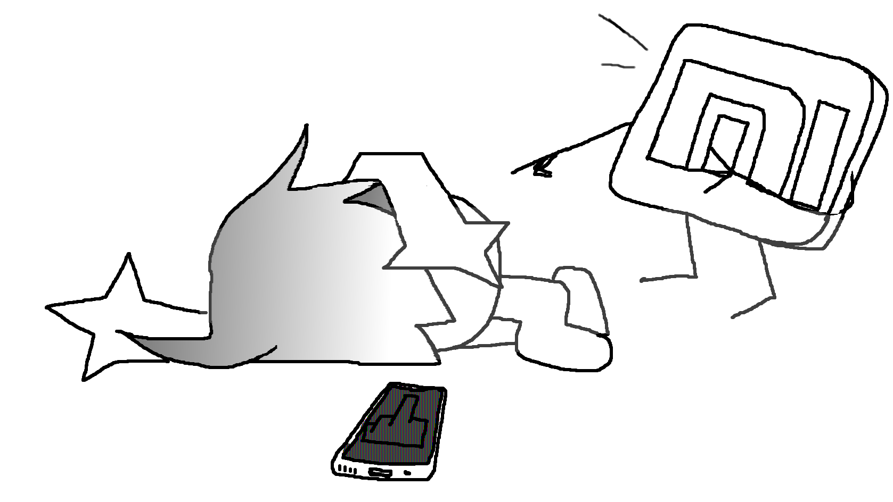
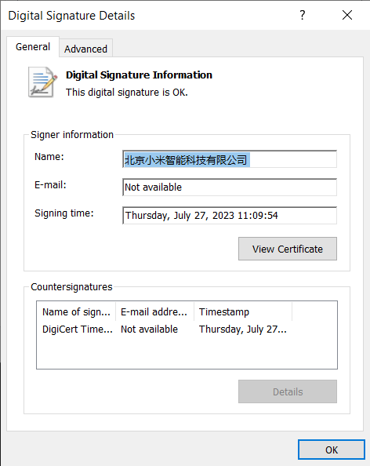
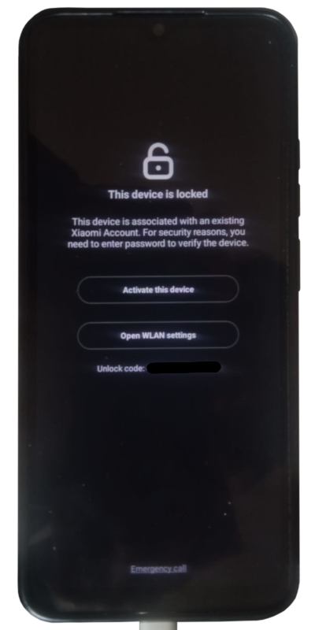
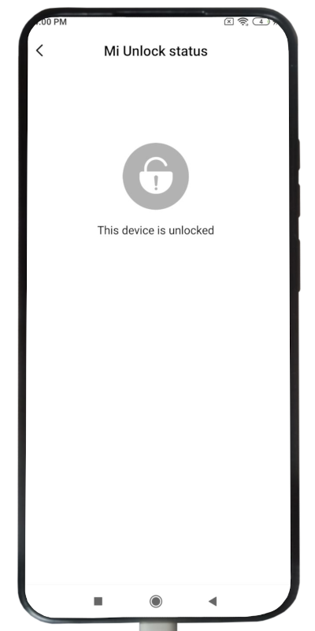

# DISCLAIMER

> [!WARNING]
> ⚠️ **Unlocking bootloader WILL erase all of the data off of the phone**,
> so BE **SURE** to make back up of your files first ⚠️  
> ❗I am **not** responsible if you brick your device, lose data or void the warranty❗
>
> It's not that scary. Just make sure you know what you are doing.

#### What Unlocking Bootloader Means
* Bootloader acts like a security lock on your phone preventing it from being easily tampered with if stolen (for example thief could flash custom modified version of your current OS but with info-stealers injected)
* Keep in mind that you can only unlock 1 device with same verified account per year. So if you have multiple Xiaomi devices choose wisely 
* Some apps like banks, online games & streaming services may refuse to work due to flagging device as untrustworthy
* Warranty and safety features may be not be valid anymore depending on your region

#### Requirements
* Xiaomi, Redmi, POCO phone with HyperOS or one of the newest MIUI builds
* Windows PC
* USB charging cable

Anyway let's get into it

# GUIDE

Unlocking bootloader on Xiaomi devices is unreasonably hard. But I managed to unlock Redmi12C in 2 days, I am gonna explain how I did it so you don't have to play this guessing game.

## Accounts Creation
> [!CAUTION]
> Before you even start creating one, **please save your log in information somewhere for Xiaomi account** (on paper, password manager like Bitwarden, etc...).  
> **Be SURE you do not forget account log in info** or your device could get soft-bricked due to FRP after factory reset or losing verified 30 day account because you had to log out and log in again in one of the steps.  

Go to **Settings > Xiaomi Account** and sign up. You cannot choose global region here, but I recommend to put **United States** (though choosing Russia didn't make much difference for me)

After this open **Xiaomi Community app** and when it asks you how you want to sign in choose **"Another Account"** and **log into your Xiaomi Account**.
then tap on **ME > Set up > Change region and set it to Global**.

Before you move onto next step **account must be at least 30+ days old to be verified & avoid errors**.

## Xiaomi Community Quota Hell
First you will need to open permission for unlocking bootloader, go to **Settings > About Phone** and **tap on OS version 7 times** which will **unlock Developer Mode**. Then leave in main **Settings > Developer options** and **enable OEM unlocking with USB debugging**.  
(OEM stands for Original Equipment Manufacturer, in this case Xiaomi. By enabling it you are allowing your system to be changed. USB debugging let's device communicate directly with PC through USB cable, which we will need for Mi Unlock Tool to detect your Xiaomi and future customization)

Main roadblock you will face is sending request at right time in Xiaomi Community to just be even able to be granted permission to unlock bootloader.
To find menu where you can send request navigate through **ME > Unlock bootloader** and there you will find "Apply for unlocking" button.

**Every day at 0:00 in Beijing time (GMT+8) quota will reset**. Only 2000 devices can apply in a day filling quota fast, and when I mean fast I mean FAST. We're talking *milliseconds*.
This comes down to their poor design choices. They could've made that every different model would have separated quota, but instead they made that EVERY model applies to same quota. So you're essentially playing "Hunger Games" with all of the Xiaomi users.

There's ways to combat this though.
* **Automated requests from PC**. [This](https://github.com/matedon/xiaomi_bypass_bootloader_unlock_quota) python script sets up Google Chrome and FireFox where you log in into your Xiaomi account so it can get Cookies to send requests to their servers. (note that you will need to download python3, Google and FireFox for it to function)
* **Manual tapping**. In case automated script doesn't work, open precise timer in separate tab on PC like [time.is](https://time.is/) and click on "Apply for unlock" on the phone right when it shows 23:59:59 in Beijing time.
Run both of this methods for about 5-10 seconds. After that you can stop as quota will almost certainly has been filled.

**After tapping on "Apply for unlock" you will see 1 of 2 messages**.
"You have been granted access to unlock until Beijing time (GMT+8) (mm/dd/yyyy)"
or
"Application quota limit reached. Please try again after (mm/dd) 00:00 Beijing time (GMT+8)"
Which one of this pops up **does not matter**, as their apps are incredibly buggy. I got failure message but it still worked.
So you can move to next step to actually find out if you have been granted the access.

## Mi Unlock Status
Go to Settings and **write in search bar "Mi Unlock status"** and tap the relevant option. You will see a list of rules that need to be done to add account and device, you probably did most just by using the phone so most important step is "2. Turn off Wi-Fi  and turn on mobile data. Make sure your device can connect to the internet using mobile data."
This step is **necessary**, so **make sure your mobile data connects to the internet**. Then you can press "Add account and device", which might display one of these messages

**Success**:
1. "Added successfully. Mi account is associated with this device now."

**Errors**:
1. "Could not add. Go to Mi Community to apply for authorization again."
  Most common one, this means that you couldn't reach for quota in right time.
2. "Couldn't verify, try adding your account and device again."
  This happens when it fails to reach Xiaomi's servers, usually because Wi-Fi is enabled instead of mobile data.
3. "The system is being upgraded. Please try again later"

But **These error messages don't really matter** much either.
If your mobile data was enabled instead of Wi-Fi and you still got "Couldn't verify, try adding your account and device again." it's because 2nd error might be also associated with phones settings not meeting Xiaomi's 'secure' & regional standards**, here's what can help you bypass it.
* Log out of Xiaomi account in Settings & clear it's cache
* Log out of Xiaomi Community & clear it's cache
* Restart device
* Go to **Settings > Additional settings > Region**, and change it to **United States**.
* In Settings search bar write "Find device" and enable it.
* In Settings search bar write "Xiaomi Cloud" and enable it too (you can disable sync it enables for storing contents of Notes, Recorder, Gallery... and etc. on Xiaomi Cloud)
* Restart device again for good measure

Log back into your Xiaomi account in Settings and Xiaomi Community account in their app. Then go back to Mi Unlock status (don't forget to turn off Wi-Fi and turn on mobile data) and press "Add account and device". Which after it should *most likely* show success message.

> [!IMPORTANT]
> Keep in mind that after you are granted permission for unlocking bootloader you have only 336 hours (14 days) to unlock your device.  
> (this is unconfirmed as I couldn't find any official answer from Xiaomi itself regarding this information, only news articles)

This may take a while and could get *really annoying*, ***really*** *fast*. But you should be certainly able to get it after 2 days, 1 week or a month with solid persistence and determination.

## Unlocking Bootloader
### Reducing Possibility of Soft-Bricking
* **Disable FRP** (Factory Reset Protection). It's is enabled automatically when you create or log into Google account on the phone. What it does is if someone tries to factory reset your phone (which happens in process of unlocking bootloader) FRP will trigger after the action and tell you to choose your Wi-Fi before asking to log into your Google account that was on device previously, to prove that this is you.  
The problem is how it's structured. It asks you to log into your Google account right ***after*** factory reset. If you are flashing custom ROM (like LineageOS) after unlocking bootloader your device might get soft-bricked. For example after flashing LineageOS and booting into system FRP could trigger asking you to log into previously used account, but because it's not same OS it can have bug where it wouldn't unlock even when you write correct Gmail and password.
  
  So to avoid this go to **Settings > Additional settings > Accounts & sync** then press on your Google account and tap on button with 3 dots on bottom and choose "Remove account" from menu.
  Do the same thing with all of your other Google accounts and it will say "Device protection features will no longer work." which is their way of saying that "FRP is disabled".

* **Disable Screen lock**. PIN is a part of FBE (File-Based Encryption). FBE works by using unique generated key to encrypt all of your data. But enabling Screen lock PIN adds another layer to this encryption, PIN acts like master key that encrypts all of your data, you cannot access almost anything before you input it in lock screen. There's no way to mechanically find PIN, only to brute force if you forgot it.  
And it can conflict with new ROM the same way it does with FRP. It might ask you for PIN on a new OS, but even if you write the correct one it will throw an error because of internal mismatch between stock OS and custom OS.
  
  To avoid this from happening go to **Settings > Fingerprints, face data and screen lock** and press on "Screen lock", write your PIN code and choose "Turn off screen lock"

### Mi Unlock Tool
Congratulations! The agonizing part is finally over. Now we just have to deal with their agonizingly buggy tool.

You can download **Mi Unlock Tool from their** [official page](https://en.miui.com/unlock/download_en.html). But it will give you **older, buggy version** that will almost certainly not display log in screen for you. It will remind you to download an update though, but upon pressing download it will throw you into web page that is... privated.
So we're gonna have to **instead download it from** [Uptodown](https://mi-unlock.en.uptodown.com/windows). (as far as I can tell this is official upload of the tool from Xiaomi due to signature not being modified)

But before opening if you extracted zip of old Mi Unlock tool **delete it's extracted files** and terminate all instances of old Mi Unlock Tool in Task Manager Because they can conflict with each other.

After you will actually be able to properly open the tool, it will meet you with log in screen where you will need to enter Xiaomi account information and phone number where they will send SMS code to your phone that you will need to write in box. It may charge money from your mobile data first time due to phone sending encrypted SMS from your device to Xiaomi's servers to test integrity of your SIM card, or it might send security code to your WhatsApp if you have your phone number tied to it (this is proven to be official feature but most services don't do this, so it might seem odd. Be sure to check WhatsApp if you can't find code)
Then it will let you use the tool to unlock the phone
* Turn off the phone
* Hold volume down and power button until it enters FastBoot mode
* Connect phone to PC with USB cable
  (if your phone does not connect in fastboot mode, try using USB 2.0)  

Which after Unlock button should be lit up. When pressing it will give you warnings that you should be already aware of, and after you confirm your choice it will make you wait for 72 hours (3 days) if you have HyperOS, or 168 hours (1 week) if you have MIUI before you can actually unlock your phone (what wait time is determined from is not confirmed, but is a community observation. In my case I have HyperOS and indeed got 72 hours)
while you wait I recommend setting up timer on PC or phone itself with same amount of hours plus 30 minutes to know when you can unlock the device for sure.

Timer works completely on side of Xiaomi's servers so you can safely close the software, unplug the phone, and hold volume down with power button until phone boots back in system.

> [!WARNING]
> **While you wait for timer to end, do NOT do these things**.  g
> 
> Do not log out of Xiaomi account  
> Do not log out of Xiaomi Community account  
> Do not press "Add account and device" in Mi Unlock status  
> Do not turn off OEM unlocking  
> Do not pull out SIM card  
> Do not turn off Find device (if you turned it on)  
> Do not turn off Xiaomi Cloud (if you turned it on)  
> Do not change your region

Basically **do not switch anything related to unlocking bootloader, or the timer will reset**. Otherwise you can use your phone as usual while you wait. If you forgot to set your timer and don't know how much time is left, you can open Mi Unlock Tool & connect your phone again as discussed before to check how much time is left.

After time is up open Mi Unlock Tool & connect your phone as previously discussed. Press "Unlock" button, agree to warnings and after it's done it will say "Unlocked successfully" press Reboot button.
And now phone will factory reset and re-download stock OS. After that it will still bother you with FRP, but through you Xiaomi account.

So Choose "Activate this device" and write your Xiaomi account password and verify that it's you through email connected to the account.
Continue through installation of stock OS as normal, disable tracking features just to be safe in "Basic Settings" step and "Google" which after you get your clear device with unlocked bootloader!

To confirm that it worked tap on **Settings > About phone** and tap on OS version 7 times to unlock Developer Mode again. Then head back to main Settings menu and write in Search bar "Mi Unlock status" and press on it, it should say "The device is unlocked".

(I lost my photo of this screen, so I made similar badly photoshoped one)  

- - -

For further modifications write in search bar "USB debugging" and enable it if you are planning to flash custom OS (like LineageOS). Also don't forget to sign out of your Xiaomi account when flashing new OS to not cause FRP that could soft-brick your device.

Enjoy the digital freedom in your pocket
